<!-- SPDX-License-Identifier: GPL-3.0-or-later -->

# Design

The colors of the suite, where they are defined and what they are for. Text colors show a sample sentence in that
color; background colors (surfaces, fills, borders and lines) show a block. The samples are SVG files in
`design/colors/`. A text sample sits on a dark or a light backdrop, whichever its color reads on; a color with
an opacity (written `#rrggbbaa` here, `#aarrggbb` in the Qt code) shows over a checkerboard. Written by
`tools/make_design.py`: change the listing there and run it.

The rules say what makes each design recognizable; the color families say, for every tint of a hue, why it is
there; the listings after them say where every color is used.

## The rules

A design is recognizable by a few colors used the same way everywhere, not by a palette of every color there is.
Each design (the suite's, the development apps') has its own; none is carried over to another.

### Bazzite Console Suite

- **The identity:** the purple of the board icon and the wiki (`#5835ce` with `#8a2be2`, the logo's `#6a1b9a`),
  and the apps' Gunmetal theme, steel gray with the steel-blue accent `#7e97ad`. Inter, with heavy titles. Every
  app has the icon of its category.
- **One theme for every app** (Gunmetal, Silver or Warm, the user's choice), from `core/bazzite_console_core/theme.py`:
  the surfaces, text and accent below. Every border that shows under the mouse, with the focus or on what is chosen
  is silver (owner, 05-11-2026), never the accent, and so is the thin border of every tooltip (owner, 07-11-2026). An
  app adds no surface or text color of its own.
- **One state family,** the same in every theme: green `#2e7d32` ok, orange `#ef6c00` warn, red `#c62828` bad,
  blue `#1565c0` info, yellow `#fdd835` running, gray `#3a3f4b` neutral. A state is an edge or a dot on the theme's
  surface; a header box or pill in the neutral state shows the blue as its edge (owner, 26-10-2026), never the
  theme's dark edge color. The portal's pills are the exception (owner, 01-11-2026): rounded rectangles in a row
  that ends level with the suite's icon, the theme's window color at 59 % so the wallpaper shows through, solid
  and framed in the silver outline when active. A
  red button is the red with `#b71c1c` pressed. Active red `#8b0000` (`#a00000` under the pointer) is a toggled-on
  state, never an error.
- **Text in a state color sits on a dark surface** in the next lighter tint of the same hue (Material's 300:
  red `#e57373`, orange `#ffb74d`, green `#81c784`, blue `#64b5f6`, purple `#ce93d8`), because the state fills read
  poorly as text on the dark views. The log in PS5 Board Test uses them; a second tint of a hue is a deviation.
- **Brand and hardware colors stay what they are:** PlayStation blue and the face-button colors in the PlayStation
  apps, the light bar's and the color wheel's pure colors in PS5 Controller, a game's own artwork, the gaming blue
  `#0a55b0` of the gaming apps in the emulator managers (blue; their icon is a silver controller with a blue light
  since 13-11-2026).
- **Anything else is a deviation**, listed under Color families below with the app it is in. A new color is
  added to the family it belongs to, or it needs a reason here.

### The development apps

- **Nexus's design** (owner, 26-10-2026: a Nexus app takes Nexus's design): near-black ink `#010101`, silver text
  `#c0c0c0` and one teal `#17b6a7` (the icon's) for every link, title and icon; nothing else. Inter, with heavy
  titles. The apps in `dev/` (Nexus Release Tool and the others) have it in their windows (core's `nexus.py`, a
  theme for core's widgets set with `create_app(theme=NEXUS)`: ink surfaces, silver text, the teal accent) and the
  Nexus icon; their states (the working tree, a build) are the apps' state family, since a build passes or fails
  there too.

## Color families

Every tint of each hue in the Bazzite Console Suite, and why it is there. *The family* is the suite's state color, *text tint* its lighter tint for text on a dark surface, *brand or icon* a color that belongs to something else (PlayStation, a tool ported, an icon), *hardware* a color the device shows, and *deviation* a second color for a job the family already has one for: there is none (the last were unified 26-10-2026).

### Red

| Color | Hex | Kind | Where and why |
| --- | --- | --- | --- |
|  | `#c62828` | the family | Bad: failed, an error, a problem; the red buttons. |
|  | `#b71c1c` | the family | A red button pressed or under the pointer (Clean up logs). |
|  | `#8b0000` | the family | Active red: a toggle button while its state is on (a toggled-on state, not an error). |
|  | `#a00000` | the family | Active red under the pointer. |
| 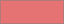 | `#e57373` | text tint | Red text on a dark surface: PS5 Board Test's findings, log, in-game checks, history and error labels; SFTP Tools' password advice not followed. |
| 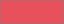 | `#e8505b` | brand or icon | PlayStation's circle: PS5 Controller's circle button, DatStation's circle symbol. |
| 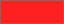 | `#ff2020` | hardware | The light bar's red; `#ff0000` the color wheel's. |

### Orange and yellow

| Color | Hex | Kind | Where and why |
| --- | --- | --- | --- |
| 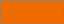 | `#ef6c00` | the family | Warn. |
| 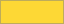 | `#fdd835` | the family | Running. |
| 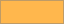 | `#ffb74d` | text tint | Orange text on a dark surface: PS5 Board Test's warnings, log and in-game checks; SFTP Tools' password warning. |
| 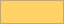 | `#ffd166` | brand or icon | DatStation's PS News symbol. |
| 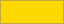 | `#ffd700` | brand or icon | DatStation's gold: trophies and stars; `#c0c0c0` silver, `#cd7f32` bronze. |
| 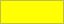 | `#ffff00` | hardware | The color wheel's yellow. |

### Green

| Color | Hex | Kind | Where and why |
| --- | --- | --- | --- |
| 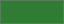 | `#2e7d32` | the family | Ok: passed, valid, unlocked, a pressed controller button; a right answer. |
| 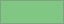 | `#81c784` | text tint | Green text on a dark surface: PS5 Board Test's log success, in-game ok and a better result in its history; SFTP Tools' password advice followed. |
| 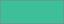 | `#3dbf9c` | brand or icon | PlayStation's triangle: PS5 Controller's triangle button, DatStation's triangle symbol. |
| 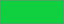 | `#10d040` | hardware | The light bar's green; `#00ff00` the color wheel's. |

### Blue

| Color | Hex | Kind | Where and why |
| --- | --- | --- | --- |
|  | `#1565c0` | the family | Info; PS5 Board Test's GPU score box; CEC Manager's adapter and display boxes. |
| 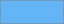 | `#64b5f6` | text tint | Blue text on a dark surface: PS5 Board Test's info and hint findings. |
|  | `#0a55b0` | brand or icon | Gaming blue, the gaming apps': the emulator managers' primary button, with `#2a6cc4` under the pointer and `#08448d` pressed; `#5b93da` their links. |
|  | `#003791` | brand or icon | PlayStation blue (DatStation), `#0072ce` light, `#1a85e0` under the pointer, `#00589f` pressed; `#4da3ef` its links. |
| 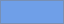 | `#6f9fe8` | brand or icon | PlayStation's cross: PS5 Controller's cross button, DatStation's cross symbol (the square is `#e48fc0` in both). |
| 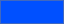 | `#0050ff` | hardware | The light bar's blue (the default); `#0000ff` the color wheel's. |

### Purple

| Color | Hex | Kind | Where and why |
| --- | --- | --- | --- |
|  | `#6a1b9a` | the family | The logo's purple, the suite's own state color. |
|  | `#5835ce` | the family | The wiki's purple, with `#8a2be2`: the suite's identity on the web. |
| 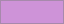 | `#ce93d8` | text tint | Purple text on a dark surface: PS5 Board Test's log hints, Show in log link, in-game accent and the overlay's frame rate and border. |
|  | `#8b4fd8` | the family | The stage pill under the claim on the wiki's home page. |
| 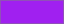 | `#a020f0` | hardware | The light bar's purple; `#ff00ff` the color wheel's magenta. |

### Palettes of their own

| Color | Hex | Kind | Where and why |
| --- | --- | --- | --- |
| 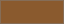 | `#8a5a2e` | brand or icon | Upscaler's copper and teal `#0e6f75` boxes, cyan `#26a9b0` outlines: the icon's colors. |
|  | `#ad1457` | brand or icon | PS5 Board Test's System overview: cores, threads `#00796b`, upload `#3949ab`, NVMe `#6d4c41`, packages `#5e35b1`, BIOS `#00838f`, a seventh series `#5d4037`: a chart's series, each told apart from the others. |

## The apps

The theme, the state colors and the style sheets are in `core/bazzite_console_core/theme.py` (bundled per app; the
apps that are not on core yet carry a copy). The theme is one choice for every app: Gunmetal, Silver or Warm.

### Gunmetal (dark, the default)

Text colors:

- `#d9dde2` Text on every surface.

  

- `#82868b` Muted text: versions, hints, placeholders, disabled buttons (text and window mixed).

  

- `#ffffff` Text on the accent (selected rows and items).

  

- `#7e97ad` Links.

  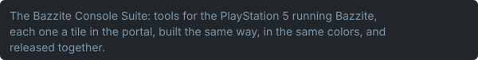

Background colors:

| Color | Hex | Used for |
| --- | --- | --- |
|  | `#2b2f34` | Window and dialog background; the selected tab. |
|  | `#22262a` | Text fields, lists, tables, tooltips, progress bars and scroll bars. |
|  | `#292d32` | Every other row of a list or table. |
| 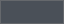 | `#4a5058` | Button face, top of its sheen; scroll bar handles. |
|  | `#3b4048` | Button face, bottom of its sheen. |
|  | `#606872` | Palette light (the button face 30 % lighter). |
|  | `#14171a` | Borders and shadows. |
| 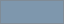 | `#7e97ad` | Accent: selection, progress. |
|  | `#c0c4c9` | Silver outline: the border under the mouse, with the focus and of the chosen tab or item (owner, 05-11-2026). |

### Silver (light)

Text colors:

- `#1e2226` Text on every surface.

  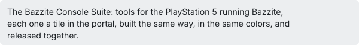

- `#7a7d81` Muted text: versions, hints, placeholders, disabled buttons.

  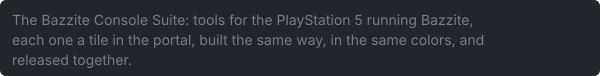

- `#ffffff` Text on the accent.

  

- `#5f7f9c` Links.

  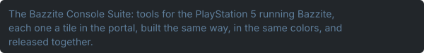

Background colors:

| Color | Hex | Used for |
| --- | --- | --- |
|  | `#d5d8dc` | Window and dialog background; the selected tab. |
| 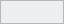 | `#eceef0` | Text fields, lists, tables, tooltips, progress bars and scroll bars. |
|  | `#e2e5e8` | Every other row of a list or table. |
|  | `#eef0f2` | Button face, top of its sheen; scroll bar handles. |
|  | `#c4c8cd` | Button face, bottom of its sheen. |
|  | `#ffffff` | Palette light (the button face 30 % lighter). |
|  | `#8d9298` | Borders and shadows. |
|  | `#5f7f9c` | Accent: selection, progress. |
|  | `#7d8389` | Silver outline, darker on the light theme: the border under the mouse, with the focus and of the chosen tab or item. |

### Warm (dark)

Text colors:

- `#e3dfd8` Text on every surface.

  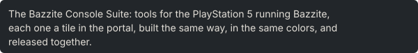

- `#8c8984` Muted text: versions, hints, placeholders, disabled buttons.

  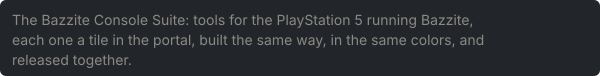

- `#1b1a18` Text on the accent.

  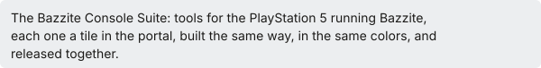

- `#b59a6e` Links.

  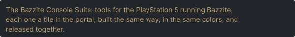

Background colors:

| Color | Hex | Used for |
| --- | --- | --- |
| 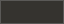 | `#35332f` | Window and dialog background; the selected tab. |
|  | `#292826` | Text fields, lists, tables, tooltips, progress bars and scroll bars. |
| 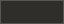 | `#302e2b` | Every other row of a list or table. |
|  | `#57534d` | Button face, top of its sheen; scroll bar handles. |
| 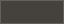 | `#45423d` | Button face, bottom of its sheen. |
|  | `#716c64` | Palette light (the button face 30 % lighter). |
| 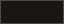 | `#181716` | Borders and shadows. |
|  | `#b59a6e` | Accent: selection, progress. |
|  | `#c0c4c9` | Silver outline: the border under the mouse, with the focus and of the chosen tab or item (owner, 05-11-2026). |

### State colors

The same in every theme: a state shows as a colored edge or dot on the theme's surfaces.

Text colors:

- `#2e7d32` Green: Passed, a valid entry.

  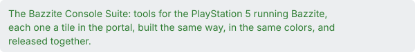

- `#c62828` Red: Failed, errors and problems in every app (the emulator managers' status lines, the Nexus Release Tool's bad tags, the upscaler's problems, a folder that is missing).

  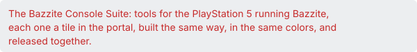

- `#ffffff` Bright text (palette BrightText); text on the state colors.

  

Background colors:

| Color | Hex | Used for |
| --- | --- | --- |
|  | `#2e7d32` | Green, ok: a state's edge or dot; an unlocked CU; a pressed controller button. |
|  | `#ef6c00` | Orange, warn. |
|  | `#c62828` | Red, bad; the red button of Clean up logs. |
|  | `#b71c1c` | The red button under the pointer or pressed (Clean up logs). |
|  | `#1565c0` | Blue, info. |
|  | `#3a3f4b` | Gray, neutral. |
|  | `#6a1b9a` | Purple, the logo's purple. |
|  | `#fdd835` | Yellow, running: never confused with a failed (red) state. |
|  | `#8b0000` | Active red: a toggle button while its state is on (core's `set_button_active`). |
|  | `#a00000` | Active red on hover. |
|  | `#1d4f91` | Steam artwork: the accent when an icon gives no bright color. |

## The wiki

`docs/stylesheets/suite.css`, Material's slate scheme with the suite's purple.

### Wiki

Text colors:

- `#ffffff` Header, hero, cards and footer text; table headings; the stage pill; buttons on the dark and accent sections.

  

- `#ffffffb3` Dimmed text on the main and the hover color: the search field's hint.

  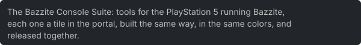

- `#a98bff` Suite soft: links in the dark scheme; hover on the dark section; footer column headings.

  

- `#c9bfee` Suite mist: card text and footer links.

  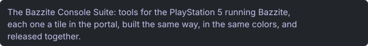

- `#1e1340` Suite deep: a button's text on hover in the dark and accent sections.

  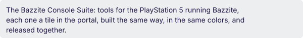

Background colors:

| Color | Hex | Used for |
| --- | --- | --- |
|  | `#5835ce` | Suite primary: Material's primary color, table headings, page icons, the hero and Get started gradients. |
|  | `#7a5ce0` | Primary, light. |
|  | `#4426a8` | Primary, dark. |
|  | `#8a2be2` | Suite secondary: the accent (hover rings on linked images), the end of the gradients. |
| 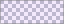 | `#8a2be21a` | The accent at 10 %. |
|  | `#1e1340` | Suite deep: header and tabs, the hero's top, the Download button. |
|  | `#120c22` | Suite ink: the dark section and the home page's footer. |
| 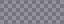 | `#120c2273` | The shadow under the board and the controller at the top of the home page (45 %). |
| 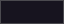 | `#17141f` | Page background (the dark scheme). |
|  | `#8b4fd8` | The stage pill under the claim. |
|  | `#ffffff` | Button background on hover in the dark and accent sections. |
|  | `#ffffff1f` | Behind a link in the header under the pointer (12 %). |
| 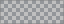 | `#00000040` | The shadow under a button under the pointer (25 %). |
| 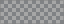 | `#00000059` | The strip with the notice at the bottom of the home page's footer (35 %). |

## The development apps

Nexus's design, in the windows of the apps in `dev/`.

### Nexus Release Tool

The window of the release tool (`dev/nrt/nexus_release_tool/style.py`): Nexus's colors as a theme for core's widgets, set with `create_app(theme=NEXUS)`; its states are the apps' state family.

Text colors:

- `#c0c0c0` Silver: the text, the title, the boxes' values and captions, the buttons, the tabs and the fields.

  

- `#010101` Ink: text on the teal accent (a selected row).

  

Background colors:

| Color | Hex | Used for |
| --- | --- | --- |
|  | `#010101` | Ink: the window, the header and the dialogs; the bottom of a button's or a box's sheen; every other row of a table. |
| 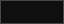 | `#0f0f0f` | Main color: the fields, lists and tables; the top of a button's or a box's sheen. |
|  | `#17b6a7` | Teal: the accent: the selection, the outline of a selected cell or a focused field, a button or pill under the pointer, the main action (Commit, Start new release, Retract), the progress bar. |
|  | `#80808066` | Dimmed silver (40 %): the borders of the fields, boxes, tabs and buttons, and a box's neutral edge. |

## The apps' own colors

On top of the theme, in the apps' `style.py` or where they are used.

### Gaming apps

Remote Play, XBOX Remote Play, PS5 Controller, PCSX2, PPSSPP, RPCS3, shadPS4, Vita3K and Xenia.

Text colors:

- `#5b93da` Links on a dark window (Remote Play, XBOX Remote Play, PCSX2, PPSSPP, RPCS3, shadPS4, Vita3K, Xenia; PS5 Controller's lit parts).

  

- `#ffffff` Text on the blue primary button and on the shortcut artwork.

  

Background colors:

| Color | Hex | Used for |
| --- | --- | --- |
|  | `#0a55b0` | Gaming blue: the primary button, hover borders; the gaming apps' color (their icon is a silver controller since 13-11-2026). |
|  | `#2a6cc4` | Gaming blue on hover. |
|  | `#08448d` | Gaming blue while pressed. |
|  | `#0a55b01a` | Blue tint (10 %): hover, every other table row. |
| 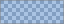 | `#0a55b059` | Blue line (35 %): outlines, a pressed button. |
|  | `#80808080` | Disabled (50 % gray). |
|  | `#5b93da` | PS5 Controller: lit parts of the controller, the chosen card. |
| 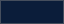 | `#0b1d3a` | shadPS4 shortcut artwork, top of the gradient. |
|  | `#030810` | shadPS4 shortcut artwork, bottom. |
|  | `#16123a` | RPCS3 shortcut artwork, top. |
| 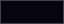 | `#05040f` | RPCS3 shortcut artwork, bottom. |
|  | `#0d2a4a` | PPSSPP shortcut artwork, top. |
|  | `#04080f` | PPSSPP shortcut artwork, bottom. |
| 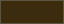 | `#3a2c0d` | Vita3K shortcut artwork, top. |
|  | `#0f0b03` | Vita3K shortcut artwork, bottom. |
|  | `#000000` | Remote Play's stream view. |

### DatStation

Text colors:

- `#4da3ef` Links on a dark window.

  

- `#0072ce` Links on a light window.

  

- `#3dbf9c` Triangle: the Quiz symbol (the face-button colors, as PS5 Controller draws them).

  

- `#e8505b` Circle: the History symbol.

  

- `#6f9fe8` Cross: the System Version History symbol.

  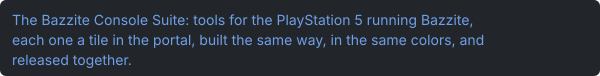

- `#e48fc0` Square: the Region Codes symbol.

  

- `#ffd166` The PS News symbol.

  

- `#ffd700` Gold: the Scores & Trophies symbol, a perfect quiz, gold stars.

  

- `#c0c0c0` Silver stars.

  

- `#cd7f32` Bronze stars.

  

- `#2e7d32` Right answers: the count and the feedback.

  

- `#c62828` Wrong answers: the count; little time left.

  

Background colors:

| Color | Hex | Used for |
| --- | --- | --- |
|  | `#003791` | PlayStation blue. |
|  | `#0072ce` | PlayStation light blue: hover borders. |
|  | `#1a85e0` | Blue on hover. |
|  | `#00589f` | Blue while pressed. |
|  | `#2e7d32` | A right answer's button. |
|  | `#c62828` | A wrong answer's button. |

### Upscaler

Text colors:

- `#3fc8cf` Links on a dark window.

  

- `#0e6f75` Links on a light window.

  

Background colors:

| Color | Hex | Used for |
| --- | --- | --- |
|  | `#8a5a2e` | Copper: boxes, white text on them. |
|  | `#0e6f75` | Teal: boxes, white text on them. |
|  | `#26a9b0` | Cyan, the icon's: button outlines. |

### PS5 Board Test (board)

Text colors:

- `#9aa0a6` Muted: versions, hints, notes, baselines, the in-game and overlay labels.

  

- `#e6e6e6` Text in the results and history views, on idle buttons, the overlay's values.

  

- `#e8e8e8` Code blocks in the README view.

  

- `#d0d0d0` The log; a disabled Clean up logs button.

  

- `#1a1a1a` Text on the yellow running button.

  

- `#333333` Labels on the graph's bars.

  

- `#e57373` Error findings; a worse result in the history; the log's errors; error labels; the in-game error.

  

- `#ffb74d` Warning findings; the log's warnings; the in-game warning.

  

- `#64b5f6` Info and hint findings.

  

- `#81c784` A better result in the history; the log's success; the in-game ok.

  

- `#ce93d8` Log: hint; the Show in log link; the in-game accent; the overlay's frame rate and thin border.

  

- `#90a4ae` Log: note.

  

- `#ffffff` README table headings.

  

Background colors:

| Color | Hex | Used for |
| --- | --- | --- |
|  | `#111418` | The log; the overlay's background (82 %). |
|  | `#1e1f24` | The results and history views; code blocks in the README view. |
|  | `#14161c` | The results card. |
|  | `#2a2f37` | The log's border. |
|  | `#3a3f4a` | The borders of the preview, setup, checks and stat cards. |
|  | `#555555` | The screenshot's border. |
|  | `#888888` | README table borders. |
|  | `#3a3f4b` | Idle buttons; README table headings; Clean up logs, disabled. |
|  | `#b71c1c` | Clean up logs under the pointer and pressed. |
|  | `#1565c0` | The GPU score box: the info blue. |
|  | `#ad1457` | System overview: cores. |
|  | `#00796b` | System overview: threads. |
|  | `#3949ab` | System overview: upload speed. |
|  | `#6d4c41` | System overview: NVMe. |
|  | `#5e35b1` | System overview: packages. |
|  | `#00838f` | System overview: BIOS; the graph's sixth series. |
|  | `#5d4037` | The graph's seventh series. |

### Other apps

Text colors:

- `#b8b8c8` System Overlay: the names of the values.

  

- `#dddddd` Remote Play's stream view.

  

- `#ffb74d` SFTP: the password warning.

  

- `#e57373` SFTP: password advice not followed.

  

- `#81c784` SFTP: password advice followed.

  

- `#2e7d32` Installer Tests: passed.

  

Background colors:

| Color | Hex | Used for |
| --- | --- | --- |
|  | `#1565c0` | CEC Manager: the adapter and display boxes. |
|  | `#000000` | PS5 Controller: the light bar off. |
|  | `#c62828` | SFTP: the errors button. |
|  | `#3dbf9c` | PS5 Controller: the triangle button. |
|  | `#e8505b` | PS5 Controller: the circle button. |
|  | `#6f9fe8` | PS5 Controller: the cross button. |
|  | `#e48fc0` | PS5 Controller: the square button. |
|  | `#0050ff` | PS5 Controller light bar: blue (the default). |
|  | `#ff2020` | Light bar: red. |
|  | `#10d040` | Light bar: green. |
|  | `#a020f0` | Light bar: purple. |
|  | `#ffffff` | Light bar: white. |
|  | `#ff0000` | The light bar's color wheel: red. |
|  | `#ffff00` | Color wheel: yellow. |
|  | `#00ff00` | Color wheel: green. |
|  | `#00ffff` | Color wheel: cyan. |
|  | `#0000ff` | Color wheel: blue. |
|  | `#ff00ff` | Color wheel: magenta. |
|  | `#04060c` | Portal: the intro's backdrop. |
|  | `#1b1b1b` | Portal: the outline of the update badge on a tile. |
|  | `#808080` | Portal: a category tab on hover (16 %). |

## Tools

### Portal screenshots

`tools/portal_screenshot.py` paints the portal in a fixed dark palette (Breeze Dark, as Bazzite's desktop shows the portal), so screenshots look the same on every machine.

Text colors:

- `#fcfcfc` Window, field, button and tooltip text.

  

- `#a1a9b1` Placeholders.

  

- `#1d99f3` Links.

  

Background colors:

| Color | Hex | Used for |
| --- | --- | --- |
|  | `#202326` | Window. |
|  | `#141618` | Fields and lists. |
|  | `#1d1f22` | Every other row. |
|  | `#292c30` | Buttons and tooltips. |
|  | `#3daee9` | Selection. |
|  | `#43474d` | Mid. |
|  | `#33373b` | Midlight. |
|  | `#101113` | Dark. |
|  | `#3d4146` | Light. |

## Icons

Every icon of the suite and where it is used. `tools/design_icons.py` reads most of this from the repository, so it stays current.

### The suite's icon

| Icon | File | Used for |
| --- | --- | --- |
|  | `portal/images/bazzite-console-suite.webp` | The portal's header (a click opens the wiki), its window icon and its tray icon. |
|  | `portal/images/bazzite-console-suite-1024.webp` | The portal's intro. |
|  | `portal/images/bazzite-console-suite-128.png` | The portal's menu entry and Desktop icon. |
|  | `portal/images/apps/portal.webp` | The portal's own tile. |
|  | `docs/images/wiki-icon.webp` | The wiki's header logo, its home page's footer and its favicon (with the .png). |
|  | `dev/nrt/images/nexus-release-tool.webp` | Every development app's icon in dev/<name>/images/: the Nexus drawing, as Nexus's apps have it. |

### The category icons

Every app has the icon of its category. `icons/categories.toml` assigns them, and `tools/sync_icons.py` copies each category's icon from `icons/<category>/` to the app's `images/`, the portal's `images/apps/` and `images/categories/`, and the wiki. The wiki's App categories page shows each app with its icon.

| Icon | Category | Apps |
| --- | --- | --- |
|  | Gaming | PCSX2 Manager (`pcsx2`) PPSSPP Manager (`ppsspp`) PS5 DatStation (`datstation`) RPCS3 Manager (`rpcs3`) Remote Play (`remoteplay`) Vita3K Manager (`vita3k`) XBOX Remote Play (`clb`) Xenia Manager (`xenia`) shadPS4 Manager (`shadps4`) |
|  | Graphics | PS5 Upscaler Manager (`upscaler`) |
|  | Sustainable | PS5 Board Test (`board`) PS5 CU Unlock (`compute`) PS5 Core Unlock (`cores`) PS5 Fan Controller (`fan`) PS5 GPU Manager (`gpu`) PS5 System Overlay (`overlay`) |
|  | Utilities | PS5 Bluetooth (`bluetooth`) PS5 CEC Manager (`cec`) PS5 Controller (`controller`) PS5 Password Generator (`password`) PS5 Quickfix (`quickfix`) PS5 SFTP Tools (`sftp`) PS5 SSD Check (`ssd`) PS5 Turing Screen (`turing`) PS5 Webcam (`webcam`) |

### The portal's symbols

Drawn with QPainter in the portal's `glyphs.py`, in the theme's text color. Each function draws one.

| Name | What it shows |
| --- | --- |
| `install` | An arrow down into a tray. |
| `reinstall` | A circular arrow. |
| `uninstall` | A waste bin. |
| `refresh` | Two arrows that chase each other around a circle. |
| `chip` | A processor: a square with pins on every side. |
| `install_apps` | Three apps of a grid of four, an arrow down in the place of the fourth. |
| `install_updates` | A circular arrow around an arrow down. |
| `menu` | ☰: three bars. |
| `minimize` | A bar: the portal hides in the system tray. As bold as the close symbol beside it. |
| `close` | A cross: the portal's exit. |
| `steam` | Steam: a disc with a piston's rod cut out of it, a large ring at its head and a small one at its foot. |
| `discord` | Discord: a round, wide face on two short legs, its two eyes cut out of it. |
| `folder` | A folder: the file manager. |
| `youtube` | A screen with a play triangle. |
| `twitch` | Twitch: a speech bubble with its lower right corner cut off, a tail at the bottom left and two eyes inside. |
| `github` | GitHub: a disc with a cat cut out of it, its head with two ears, its body and its tail. |
| `bluetooth` | The Bluetooth rune. |
| `network` | Three arcs over a dot: the network. |
| `volume` | A loudspeaker with two waves of sound: the volume. |
| `screen` | A screen on its foot: the display. |

### The desktop style's icons

Icons the apps take from the desktop's style or icon theme, so they look different on every desktop. The name is Qt's standard pixmap or the icon theme's name.

| Name | Used by |
| --- | --- |
| `SP_BrowserReload` | Nexus Deps |
| `SP_MessageBoxInformation` | PS5 Board Test, Nexus Deps |
| `SP_MessageBoxWarning` | PS5 Board Test |
| `view-refresh` | Nexus Deps |

### Material Design icons in the wiki

Drawn by MkDocs Material in the wiki's colors.

| Icon | Name | Pages |
| --- | --- | --- |
|  | `material-chip` | What is the PlayStation 5? |
|  | `material-code-braces` | Development |
|  | `material-download` | Bazzite Console Suite { .home-hero__lead } |
|  | `material-expansion-card` | Bazzite Console Suite { .home-hero__lead } |
|  | `material-eye-off-outline` | Privacy |
|  | `material-fan` | Bazzite Console Suite { .home-hero__lead } |
|  | `material-gamepad-variant` | Bazzite Console Suite { .home-hero__lead } |
|  | `material-github` | GitHub settings |
|  | `material-harddisk` | PS5 Linux boot partition |
|  | `material-image-multiple-outline` | Covers from SteamGridDB |
|  | `material-linux` | What is Bazzite? |
|  | `material-lock-open-variant` | Bazzite Console Suite { .home-hero__lead } |
|  | `material-play-circle-outline` | Portal Tour |
|  | `material-shape-outline` | App categories |
|  | `material-shield-lock-outline` | Security |
|  | `material-sitemap-outline` | Architecture and consistency |
|  | `material-speedometer` | Bazzite Console Suite { .home-hero__lead } |
|  | `material-stethoscope` | Bazzite Console Suite { .home-hero__lead } |
|  | `material-tag-outline` | Releases |
|  | `material-television` | Bazzite Console Suite { .home-hero__lead } |
|  | `material-television-play` | Bazzite Console Suite { .home-hero__lead } |
|  | `material-tray-arrow-down` | Install |
|  | `material-video-wireless-outline` | Remote Play: the stream's threads |
|  | `material-view-dashboard-outline` | Dashboard |
|  | `material-view-grid-outline` | Apps |

### Characters as icons

Characters of the font that the apps use as icons in labels and buttons.

| App | Characters |
| --- | --- |
| Portal | ● ☰ |
| Every app on core | ✓ ● ↻ |
| Nexus Deps | ✓ ✗ |
| Nexus Installer Tests | ✓ ✗ |
| Nexus Release Tool | ✓ ▶ ● ↓ ↑ |
| PS5 Board Test | ✔ ✖ ✕ ⚠ ▶ ■ ↓ ↑ › 💡 🎮 |
| PS5 CU Unlock | ■ |
| PS5 Controller | ✓ ✕ › △ ○ □ |
| PS5 Core Unlock | ✔ ✖ ▶ ■ |
| PS5 DatStation | ← △ ○ □ ◇ ◆ ★ |
| PS5 GPU Manager | ✔ ✖ ⚠ ▶ ● |
| PS5 Quickfix | ● ○ |
| PS5 SFTP Tools | ✓ ✗ ⚠ ↓ ↑ ← |
| PS5 System Overlay | ↓ ↑ |
| PS5 Turing Screen | ↓ ↑ |
| PS5 Webcam | ✓ ● |
| Remote Play | ✓ ✗ |
