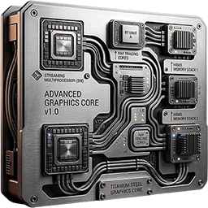
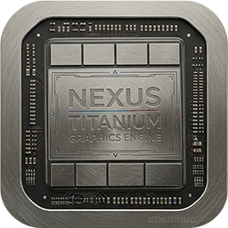
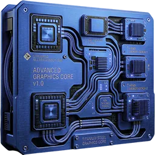

<!-- SPDX-License-Identifier: GPL-3.0-or-later -->

# Bazzite Console Suite

Control your PlayStation 5 running Bazzite. The portal installs and opens the suite's apps. Board Test is always installed and listed first; it is the only required app.

**Beta:** The suite is in active development: features and layout may still change between releases.

**Sustainable**: system and device information, and what keeps the board cool.

-  **[PS5 Board Test](apps/board)**: Read-only system details for PlayStation 5 hardware running Bazzite.
-  **[PS5 System Overlay](apps/overlay)**: A small always-on-top window with the PS5's live CPU, GPU, memory, fan and temperature values.
-  **[PS5 Fan Controller](apps/fan)**: The PS5's temperatures and fan, and a thermal guard that warns, cools and shuts down cleanly at a critical temperature.
-  **[PS5 CU Unlock](apps/compute)**: Tell bad CUs apart from an unstable CU unlock, and apply a tested unlock.
-  **[PS5 Core Unlock](apps/cores)**: Tell bad CPU cores apart from an unstable core unlock, before you persist the 8C/16T unlock.
-  **[PS5 GPU Manager](apps/gpu)**: Manage the cyan-skillfish GPU governor, with tuning, safe points, profiles and backups.

**Graphics**: Graphics features and tools for games.

-  **[PS5 Upscaler Manager](apps/upscaler)**: Deploy HelixSR (FSR 3.1 drop-in upscaler with DLSS-style networks) into games.

**Gaming**: Emulators and console tools for games.

-  **[RPCS3 Manager](apps/rpcs3)**: Install RPCS3 for PS3 games, manage game libraries, and add games to Game Mode.
-  **[Remote Play](apps/remoteplay)**: Find, wake, and register PS4 and PS5 consoles on the network, and stream Remote Play.
-  **[XBOX Remote Play](apps/clb)**: Stream XBOX consoles or XBOX Cloud Gaming after signing in with a Microsoft account.
-  **[shadPS4 Manager](apps/shadps4)**: Install shadPS4 for PS4 games, manage game libraries, and add games to Game Mode.
-  **[PS5 DatStation](apps/datstation)**: Play a PlayStation quiz and explore console history, system versions, region codes, manuals, and news.
-  **[PPSSPP Manager](apps/ppsspp)**: Install PPSSPP for PSP games, manage game libraries, and add games to Game Mode.
-  **[PCSX2 Manager](apps/pcsx2)**: Install PCSX2 for PS2 games, manage BIOS and game libraries, and add games to Game Mode.
-  **[Vita3K Manager](apps/vita3k)**: Install Vita3K for PS Vita games and add installed titles to Game Mode.
-  **[Xenia Manager](apps/xenia)**: Install Xenia Canary for XBOX 360 games and add games to Game Mode.

**Utilities**: Tools for files, peripherals, and storage.

-  **[PS5 SFTP Tools](apps/sftp)**: Transfer files over SFTP and manage SSH servers on Bazzite hosts.
-  **[PS5 Webcam](apps/webcam)**: Use a compatible PlayStation camera as a webcam.
-  **[PS5 Controller](apps/controller)**: Manage DualSense and DualSense Edge controllers.
-  **[PS5 SSD Check](apps/ssd)**: Inspect storage health and drive information when supported.
-  **[PS5 CEC Manager](apps/cec)**: Turn the TV on and off with the PS5, switch its input and use its remote, over HDMI-CEC.
-  **[PS5 Bluetooth](apps/bluetooth)**: Pair your Bluetooth keyboard, mouse and controllers at boot, with no USB keyboard or mouse needed.
-  **[PS5 Quickfix](apps/quickfix)**: Small quickfixes for one job each: Board Test's optional tools, MangoHud's config, the memory map, the journal and the boot command line. Always installed.
-  **[PS5 Password Generator](apps/password)**: Makes a random password of 8 or 15 characters with a capital letter, a small letter, a number and a special character, and keeps it nowhere.
-  **[PS5 Turing Screen](apps/turing)**: CPU, GPU, memory, fan and temperatures on a Turzx USB IPS screen (Turing Smart Screen 3.5").

The tools for working on the suite run from a checkout of the repository. They are not in the portal.
**[Nexus Dashboard for PS5](dev/dash)** opens them all.

- Nexus Release Tool
- Nexus Installer Tests
- Nexus Demo Recorder
- Nexus Sound Lab
- Nexus TTS
- Nexus Remix Studio
- The video tours and the icons

## Install

You install one thing, the portal; it installs the apps. The
[Install page of the wiki](https://robertotorino.github.io/bazzite-console/install/) has the few lines to paste into a
terminal. The download itself is the [latest release](https://github.com/RobertoTorino/bazzite-console/releases/latest),
which is always the portal's; the other releases are the apps', which the portal downloads for you.

How to use the suite: [the wiki](https://robertotorino.github.io/bazzite-console/).

## License

GPL-3.0-or-later, see [LICENSE](LICENSE).

## Disclaimer

Bazzite Console is an independent community project, not affiliated with or endorsed by AMD, ASRock, the Bazzite / Universal Blue project, Sony, Microsoft, Valve, or the makers of the emulators and the other programs the apps work with. Bazzite is developed by the Universal Blue project. PlayStation, PS4, PS5, PS3, PS2, PSP, PS Vita, PSN, DualSense and Remote Play are Sony's; XBOX, XBOX 360, XBOX Cloud Gaming, Game Pass and Windows are Microsoft's; Steam, Steam Deck and Big Picture are Valve's; the names of the emulators (shadPS4, RPCS3, PPSSPP, PCSX2, Vita3K, and Xenia) belong to their owners. The project uses their names only to say what its apps work with.
