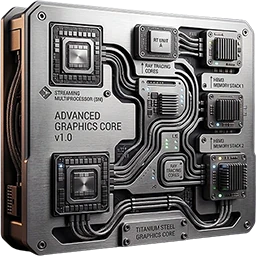
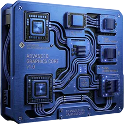

<!-- SPDX-License-Identifier: GPL-3.0-or-later -->

# Bazzite Console Suite

Control your PlayStation 5 running Bazzite. The portal installs and opens the suite's apps. Bazzite Test is always installed and listed first; it is the only required app.

**Sustainable**: system and device information, and what keeps the console cool.

-  **[Bazzite Test](apps/bazzite)**: Read-only system details for PlayStation 5 hardware running Bazzite.
-  **[System Overlay](apps/overlay)**: A small always-on-top window with the PS5's live CPU, GPU, memory, fan and temperature values.
-  **[Fan Control](apps/fan)**: The PS5's temperatures and fan, and a thermal guard that warns, cools and shuts down cleanly at a critical temperature.

**Gaming**: Emulators and console tools for games.

-  **[RPCS3 Manager](apps/rpcs3)**: Install RPCS3 for PS3 games, manage game libraries, and add games to Game Mode.
-  **[Remote Play](apps/remoteplay)**: Find, wake, and register PS4 and PS5 consoles on the network, and stream Remote Play.
-  **[Xbox Remote Play](apps/clb)**: Stream Xbox consoles or Xbox Cloud Gaming after signing in with a Microsoft account.
-  **[shadPS4 Manager](apps/shadps4)**: Install shadPS4 for PS4 games, manage game libraries, and add games to Game Mode.
-  **[Bazzite DatStation](apps/datstation)**: Play a PlayStation quiz and explore console history, system versions, region codes, manuals, and news.
-  **[PPSSPP Manager](apps/ppsspp)**: Install PPSSPP for PSP games, manage game libraries, and add games to Game Mode.
-  **[PCSX2 Manager](apps/pcsx2)**: Install PCSX2 for PS2 games, manage BIOS and game libraries, and add games to Game Mode.
-  **[Vita3K Manager](apps/vita3k)**: Install Vita3K for PS Vita games and add installed titles to Game Mode.
-  **[Xenia Manager](apps/xenia)**: Install Xenia Canary for Xbox 360 games and add games to Game Mode.

**Utilities**: Tools for files, peripherals, and storage.

-  **[SFTP Tools](apps/sftp)**: Transfer files over SFTP and manage SSH servers on Bazzite hosts.
-  **[Webcam](apps/webcam)**: Use a compatible PlayStation camera as a webcam.
-  **[Controller](apps/controller)**: Manage DualSense and DualSense Edge controllers.
-  **[SSD Check](apps/ssd)**: Inspect storage health and drive information when supported.
-  **[HDMI CEC Manager](apps/cec)**: Turn the TV on and off with the PS5, switch its input and use its remote, over HDMI-CEC.

How to install and use the suite: [the wiki](https://robertotorino.github.io/nexus/bazzite-console-suite/).

## License

GPL-3.0-or-later, see [LICENSE](LICENSE).

## Media trademarks

The X (formerly Twitter), Instagram, Discord, TikTok, WhatsApp, Netflix and Spotify names and marks belong to their respective owners. The Simple Icons artwork used for the portal's Media launcher cards is dedicated under [CC0 1.0](https://github.com/simple-icons/simple-icons/blob/develop/LICENSE.md); that dedication does not grant trademark rights. The names and marks identify third-party services only and do not imply affiliation with or endorsement by their owners.

## Disclaimer

Bazzite Console is an independent community project, not affiliated with or endorsed by AMD, ASRock, the Bazzite / Universal Blue project, Sony, Microsoft, Valve, or the makers of the emulators and the other programs the apps work with. Bazzite is developed by the Universal Blue project. PlayStation, PS4, PS5, PS3, PS2, PSP, PS Vita, PSN, DualSense and Remote Play are Sony's; XBOX, XBOX 360, XBOX Cloud Gaming, Game Pass and Windows are Microsoft's; Steam, Steam Deck and Big Picture are Valve's; the names of the emulators (shadPS4, RPCS3, PPSSPP, PCSX2, Vita3K and Xenia) belong to their owners. The project uses them only to say what its apps work with.
