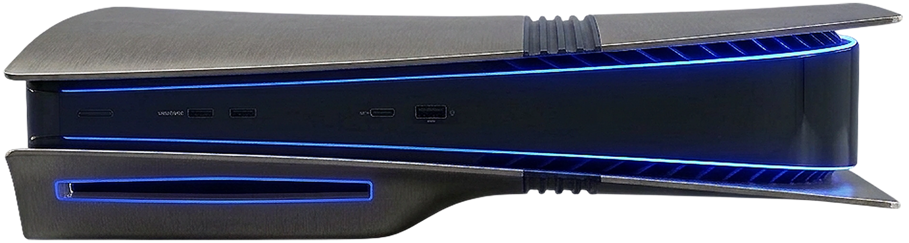
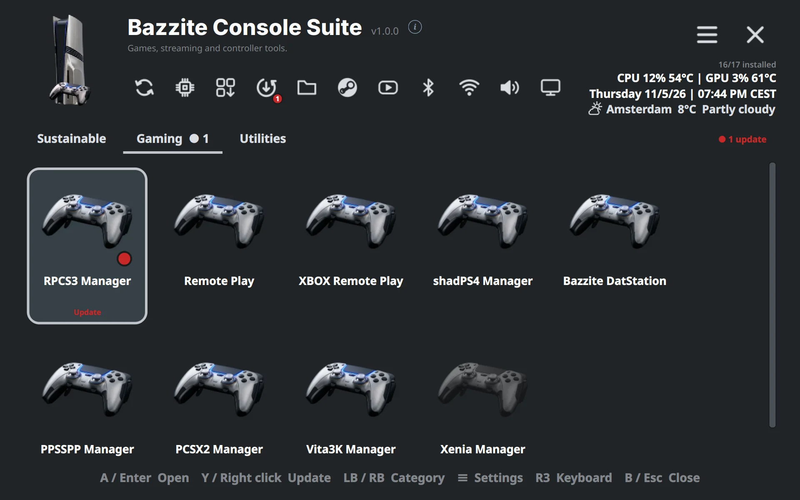

<!-- SPDX-License-Identifier: GPL-3.0-or-later -->

<section class="home-hero" markdown>

{ .home-hero__board }
{ .home-hero__controller }

# Bazzite Console Suite { .home-hero__lead }

Control your PlayStation 5 running Bazzite.

<strong>Beta</strong> The suite is in active development: features and layout may still change between releases.

</section>

<section class="home-section home-section--dark" markdown>

## What's in the suite?

#### :material-stethoscope: Diagnostics

[Bazzite Test](apps/bazzite.md) checks the console with about sixty tests,
[System Overlay](apps/overlay.md) keeps CPU, GPU, memory, fan and temperatures on top, and
[SSD Check](apps/ssd.md) shows the drives' health and information.

#### :material-fan: Cooling

[Fan Control](apps/fan.md) shows the temperatures and the fan, and its thermal guard warns, cools and shuts the
console down cleanly at a critical temperature.

#### :material-expansion-card: Graphics

Graphics features and tools for games. [Coming soon.](apps/graphics.md)

#### :material-gamepad-variant: Gaming

[shadPS4 Manager](apps/shadps4.md) plays PS4 games, [RPCS3 Manager](apps/rpcs3.md) PS3 games,
[PCSX2 Manager](apps/pcsx2.md) PS2 games, [PPSSPP Manager](apps/ppsspp.md) PSP games,
[Vita3K Manager](apps/vita3k.md) PS Vita games and [Xenia Manager](apps/xenia.md) XBOX 360 games, each with its
emulator, and [Bazzite DatStation](apps/datstation.md) has a PlayStation quiz and console history.

#### :material-television-play: Streaming

[Remote Play](apps/remoteplay.md) finds, wakes and registers PS4 and PS5 consoles and streams them, and
[XBOX Remote Play](apps/clb.md) streams XBOX consoles and XBOX Cloud Gaming.

#### :material-television: Living room

[HDMI CEC Manager](apps/cec.md) turns the TV on and off with the PS5, [SFTP Tools](apps/sftp.md) moves files
between computers, [Webcam](apps/webcam.md) makes a PlayStation camera a webcam, and
[Controller](apps/controller.md) manages DualSense controllers and updates their firmware.

[All the apps](apps/index.md){ .md-button }

</section>

<section class="home-section home-section--light" markdown>

## One dashboard for all the apps

The portal installs, opens, updates and removes the apps, fullscreen, with the keyboard, the mouse or a
controller. Each app is a tile: press it to open it, and its menu installs or uninstalls. A red dot shows an update.
Apps that **change the board** are marked, and the portal asks before it installs or opens them.

[About the portal](portal.md){ .md-button }

{ .home-split__picture }

</section>

<section class="home-section home-section--accent" markdown>

## Get started

Ready to set up your PlayStation 5? One download installs the **portal**: a fullscreen app library for the
controller, the keyboard and the mouse. It installs Bazzite Test with it, and from it you install, open, update and
remove every other app of the suite. You never download an app yourself.

[:material-download: Install the portal](install.md){ .md-button .md-button--primary }
[How the portal works](portal.md){ .md-button }

</section>

<section class="home-section home-faq" markdown>

## FAQ

### Do the apps change my console?

Only the apps marked **changes the board**: Fan Control's thermal guard, Webcam's camera access and the SSH server
that SFTP Tools starts. They are software-only and can be undone, and the portal says what the app changes and asks
before it installs or opens it. Each of their chapters opens with a **Changes the board** box with the same text:
what the app touches, what stays after a reboot and how the change is undone. Bazzite Test only reads.

### How do I undo a change?

In the app that made it: turn the thermal guard off in [Fan Control](apps/fan.md), and stop the SSH server in
[SFTP Tools](apps/sftp.md#manage-ssh-servers), which leaves the firewall's rule for you to review. Uninstalling
[Webcam](apps/webcam.md) removes its camera rule, and uninstalling Fan Control removes the guard.

### Do the apps change the console's own driver?

No. The apps read what the kernel's drivers for the console offer and install no driver of their own. Bazzite's own
packages and their updates are Bazzite's.

### Do the emulators come with games?

No. The managers install the emulators and add your games to Steam and Game Mode. The games, and the firmware or
BIOS an emulator needs, are yours to supply.

### Do I have to install the apps one by one?

No. Install the portal; it installs, updates and removes the apps, each from a tested release that it checks
before it unpacks it. See [Install](install.md).

### Does it work on other systems?

The suite is made for PlayStation 5 hardware running Bazzite.

### How do I check a download?

Every release comes with a `SHA256SUMS` file, and the lines on the Install page check the download with it before
they unpack it. See the [security policy](SECURITY.md#verifying-a-download).

### Is it open source?

Yes. The code of every app is on [GitHub](https://github.com/RobertoTorino/bazzite-console), under the licenses
below.

### What does the suite know about me?

Nothing it sends anywhere: no accounts, statistics or crash reports. What goes over the network, and when, is on the
[Privacy](privacy.md) page.

### Where do I get help?

Open an issue on [GitHub](https://github.com/RobertoTorino/bazzite-console/issues). For a security problem,
use **Security → Report a vulnerability** instead, as the [security policy](SECURITY.md) says.

## License

GPL-3.0-or-later, except Remote Play, which is AGPL-3.0 (its protocol code comes from chiaki-ng). Each app has its
own `LICENSE`. The icons were made with generative AI tools and edited by hand in Photoshop, and the music of the
video tours with generative AI tools. The sounds were made without AI: the portal's intro sound by its own code, from
arithmetic alone, and the portal's sound on a controller action and DatStation's quiz music by hand in Audacity. All
are under the license of the app or tool they come with, like its code.

</section>
